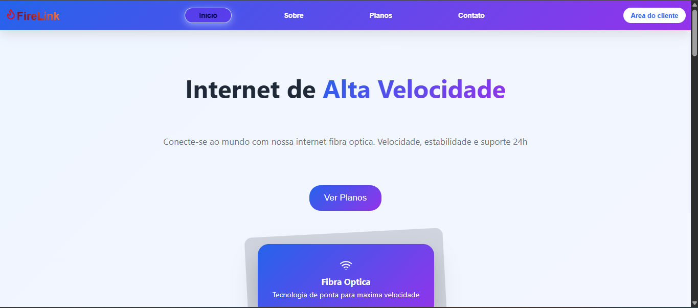

# FireLink  
Landing Page para Provedor de Internet Fibra Óptica

FireLink é uma landing page institucional desenvolvida para apresentar os serviços, planos e benefícios de um provedor de internet fibra óptica de forma clara, moderna e atrativa. O projeto foi pensado para oferecer uma experiência visual agradável e navegação intuitiva.

**Acesse o projeto:** https://thaylanbf1.github.io/FireLink-Project/

---

##  Sobre o Projeto

Este projeto foi desenvolvido com foco em **componentização**, **organização de layout** e **experiência do usuário**, simulando um site real de empresa.  
A interface destaca planos, diferenciais e depoimentos de clientes, buscando transmitir confiança e credibilidade.

---

##  Funcionalidades

- Seção de planos com detalhes de velocidade e preço  
- Apresentação de recursos e benefícios (alta velocidade, conexão segura, suporte 24h)  
- Depoimentos de clientes para gerar confiança  
- Cabeçalho com navegação por âncoras e rolagem suave  
- Layout moderno e organizado  

---

##  Tecnologias Utilizadas

- React  
- Vite  
- Lucide React  
- CSS  

---

##  Preview



---

##  Como executar o projeto localmente

```bash
# Clone o repositório
git clone https://github.com/thaylanbf1/FireLink-Project.git

# Acesse a pasta do projeto
cd FireLink-Project

# Instale as dependências
npm install

# Inicie o servidor de desenvolvimento
npm run dev
